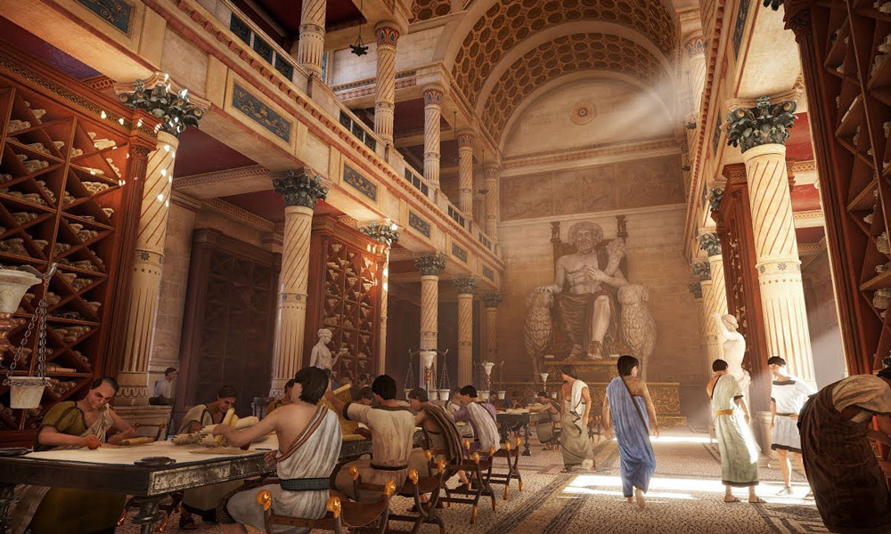

<p align="center">
  
</p>

<h1 align="center">Alexandria</h1>

<p align="center">
  <strong>A personal AI-powered knowledge library that transforms reading into an interactive, cumulative, and connected learning process.</strong>
</p>

<p align="center">
  <em>Reading assistant. Knowledge base. Graph explorer. One place.</em>
</p>

---

Alexandria combines three roles in a single system: **Atlas**, an AI reading companion that understands your text in context; a **semantic knowledge base** that retrieves meaning across a growing document collection via vector search (RAG); and a **knowledge graph explorer** that reveals how ideas, sources, and concepts connect across everything you've read (GraphRAG) -- visualized as a night-sky constellation map.

The core idea is that AI assistance is embedded directly into the reading experience, not accessed through a separate chat window. Every document ingested feeds both a semantic retrieval layer and a structured knowledge graph. The system grows smarter as you read more.

## Features

### The Archive -- Library View
Documents are scrolls stored in mahogany cabinets with diamond-lattice fronts, organized by collection. Upload PDFs by drag-and-drop, browse your archive, and track reading progress. The visual language draws from architectural renders of the ancient Library of Alexandria -- sandstone, teal friezes, torchlight gold.

### The Scholar's Desk -- Reader View
A two-panel reading interface: the PDF on the left, Atlas's chat panel on the right. Select any passage and ask about it, highlight it, get a quick definition, or search for similar passages across your entire library. Highlights persist in four palette colors with optional annotations.

### Atlas -- AI Reading Companion
Atlas is not a generic chatbot. He is a scholarly companion with a three-layer memory system:

- **Short-term**: tracks the current conversation thread
- **Medium-term**: remembers past discussions about each document
- **Long-term**: builds a profile of your knowledge, interests, and preferences across your entire library

Atlas operates in three modes:
- **Passage mode** -- explain a highlighted selection in context
- **Document mode** -- search and reason across the current document
- **Library mode** -- synthesize knowledge across your entire collection

For complex questions, Atlas uses a **ReAct agent loop** -- reasoning about what tools to use, searching your library and knowledge graph, reading document sections, and iterating until he has a complete answer. Every response includes clickable source references (`[p.12]`) that scroll the PDF to the cited location.

### The Observatory -- Constellation Map
The knowledge graph is visualized as a night sky. Concepts are stars. Relationships are constellation lines. Zooming in reveals more detail; zooming out shows the shape of everything you've studied. Node size encodes importance, color encodes type (concepts, papers, authors, topics, methods), and glow effects create the atmosphere of stargazing.

The transition from library to constellation is "looking up" -- stepping outside the archive columns and tilting your head toward the sky of connected ideas.

### Ingestion Pipeline
Upload a document and Alexandria handles the rest:

```
Upload -> Parse -> Structure -> Chunk -> Embed -> Index -> Extract Graph -> Link
```

Text is extracted with structural awareness (sections, headings, references), chunked with overlap, embedded into vectors, indexed for semantic search, and processed through an LLM to extract entities, concepts, and relationships for the knowledge graph. Cross-document linking discovers connections automatically.

### Citation Explorer
References are parsed, identified, and resolved against external APIs (CrossRef, Semantic Scholar, OpenAlex, arXiv). Cited works already in your library are linked. Others can be added with one click.

## Tech Stack

| Layer | Technology |
|-------|-----------|
| Runtime | **Bun** (everywhere) |
| Language | **TypeScript** (end-to-end) |
| Frontend | Next.js 15 (App Router), shadcn/ui, Tailwind CSS, Zustand, react-pdf |
| Backend | Hono on Bun |
| Database | PostgreSQL 16 + pgvector (relational + vector in one DB) |
| ORM | Drizzle ORM + Drizzle Kit migrations |
| AI/LLM | pi-mono (multi-provider: OpenAI, Anthropic, local via Ollama) |
| Job Queue | BullMQ + Redis |
| Graph Viz | 2D Canvas (D3.js / PixiJS) with glow/bloom effects |
| PDF Parsing | pdf-parse |

Monorepo with Bun workspaces: `frontend/`, `backend/`, `packages/shared/`.

## Getting Started

### Prerequisites

- [Bun](https://bun.sh) (v1.0+)
- [Docker](https://docs.docker.com/get-docker/) and Docker Compose

### Setup

```bash
# Clone the repository
git clone https://github.com/felipequiterio/alexandria.git
cd alexandria

# First-time setup: starts Docker containers, installs dependencies,
# enables pgvector, and pushes the database schema
make setup
```

### Development

```bash
# Start everything (Docker + frontend + backend)
make dev
```

The frontend runs at `http://localhost:3000` and the backend API at `http://localhost:3001`.

### Other Commands

```bash
make dev-frontend    # Frontend only
make dev-backend     # Backend only
make db-push         # Push schema changes to the database
make db-studio       # Open Drizzle Studio (DB browser)
make db-shell        # Open a psql shell
make docker-up       # Start Docker containers
make docker-down     # Stop Docker containers
make docker-reset    # Reset everything (destroys data)
make logs            # Tail Docker container logs
make build           # Production build
make clean           # Remove node_modules and build artifacts
```

## Project Structure

```
alexandria/
├── packages/
│   └── shared/              # Shared types and validation schemas
│       └── src/types/       # Domain models, API contracts
│
├── frontend/                # Next.js 15 application
│   └── src/
│       ├── app/             # App Router pages
│       ├── components/      # UI components by domain
│       ├── hooks/           # Custom React hooks
│       ├── lib/             # Utilities, API client
│       └── stores/          # Zustand stores
│
├── backend/                 # Hono API server on Bun
│   └── src/
│       ├── routes/          # API route handlers
│       ├── db/              # Drizzle schema + migrations
│       ├── services/        # Business logic (ingestion, AI, retrieval)
│       └── config/          # Environment configuration
│
├── reference/               # Design reference images
├── docker-compose.yml       # PostgreSQL (pgvector) + Redis
├── Makefile                 # Development commands
├── PLAN.md                  # Full development plan and architecture
└── bun.workspace.ts         # Bun monorepo config
```

## Design Vision

The interface draws from architectural renders of the ancient Library of Alexandria. Not a literal recreation, but an atmosphere distilled from it: warm limestone, rich mahogany, Mediterranean teal, torchlight gold.

**Light mode ("The Archive")** -- sandy limestone backgrounds, mahogany surfaces, teal accent for interactive elements, gold for highlights and important markers.

**Dark mode ("The Observatory")** -- deep indigo-black sky, celestial gold accents, constellation silver, nebula rose. The knowledge graph defaults to this mode because it *is* the night sky.

<p align="center">
  
</p>

## Development Status

Alexandria is under active development.

- [x] **Phase 1: Foundation** -- Project scaffolding, document upload, PDF reader, library view
- [x] **Phase 2: AI-Assisted Reading** -- Chunking, embeddings, Atlas chat, highlights, passage Q&A
- [ ] **Phase 3: Library Intelligence** -- Cross-document RAG, library-level chat, Atlas agent system
- [ ] **Phase 4: Knowledge Graph** -- Graph extraction, GraphRAG, constellation visualization
- [ ] **Phase 5: Citations & References** -- Extraction, resolution, citation graph
- [ ] **Phase 6: Polish** -- Full scholarly UI theme, performance, testing

See [PLAN.md](PLAN.md) for the complete architecture, data models, and feature specifications.

## License

This project is not yet licensed for distribution. All rights reserved.
